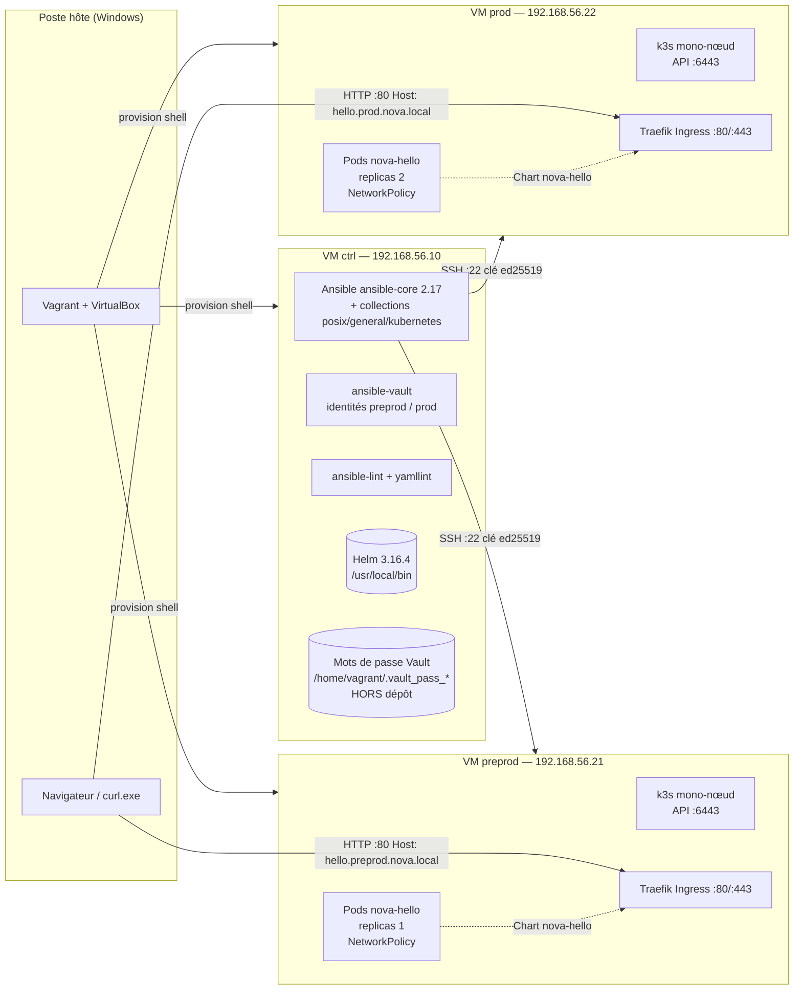

# Architecture nova-lab (TP15 — dossier de rendu)

## Vue d'ensemble

## Rôle de chaque outil

| Outil | Rôle | Pourquoi lui |
|---|---|---|
| **Vagrant + VirtualBox** | Provision des 3 VM reproductibles (Vagrantfile déclaratif) | Reconstruction from-scratch prouvée au TP15 |
| **Ansible** (sur `ctrl`) | Configuration du socle, accès, durcissement, déploiement, audit (push, agentless) | Voir ADR-01 |
| **ansible-vault** | Chiffrement des secrets, une identité par environnement (`vault_identity_list`) | Aucun secret en clair dans Git |
| **k3s** (sur chaque nœud) | Kubernetes complet allégé, API :6443, Traefik intégré | ADR-02 |
| **Helm** (sur le nœud, module `kubernetes.core.helm`) | Déploiement applicatif versionné du chart `nova-hello` (annotations checksum, NetworkPolicy) | ADR-04 |
| **Goss** (sur chaque nœud) | Audit de conformité Compliance-as-Code (28 contrôles baseline + 11/13 k3s) | ADR-05 |
| **ufw** | Pare-feu liste blanche + isolation preprod↔prod (PSSI-08) | DER-01 (mesure compensatoire) |

## Flux autorisés (ufw, liste blanche — défaut : deny in)

| Source | Destination | Port | Usage |
|---|---|---|---|
| ctrl (192.168.56.10) | preprod / prod | 22/tcp | SSH Ansible |
| NAT Vagrant (10.0.2.0/24) | preprod / prod | 22/tcp | SSH de secours hôte |
| ctrl | preprod / prod | 80/tcp | Smoke tests HTTP |
| Poste hôte (192.168.56.1) | preprod / prod | 80, 443 | Navigation utilisateur |
| ctrl | prod | 6443/tcp | API k3s |
| Réseaux internes k3s (10.42/16, 10.43/16) | local | any | Pods ↔ services (klipper DNAT) |
| **preprod ↔ prod** | — | any | **DENY OUT (PSSI-08, filtrage à la source)** — DER interdit cross-env |

## Limites assumées du labo

- 2 Go de RAM par nœud, réseau campus intermittent (port 80 filtré par intermittence — provisions résilients intégrés) ;
- un seul nœud par environnement (k3s mono-nœud), pas de Ha ;
- pas de GitOps (Argo CD) ni de supervision centralisée : hors périmètre des TP.
